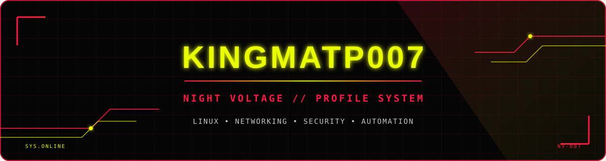

  

  
  
  

## `01 // ABOUT`

> Curious about how systems work, how networks connect, and how software can be made more useful.

I enjoy experimenting with **Linux**, **networking**, **cybersecurity**, and **automation**. This profile is where I document projects, experiments, and things I'm learning along the way.

## `02 // CURRENT INTERESTS`

- Linux systems and desktop customization
- Networking and infrastructure
- Cybersecurity fundamentals and hands-on labs
- Scripting, automation, and practical tools

## `03 // TECH INTERESTS`

  
  
  
  
  

## `04 // PROJECTS`

Pinned repositories are the best place to find the projects I'm working on. More experiments and documentation will appear here as they develop.

## `05 // CONNECT`

  

  <code>POWERED BY CURIOSITY // BUILT IN THE DARK</code>

